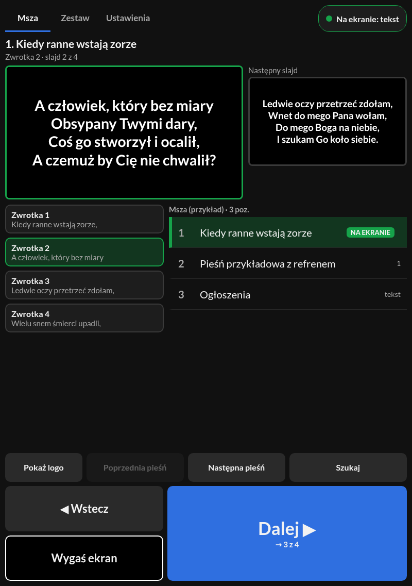
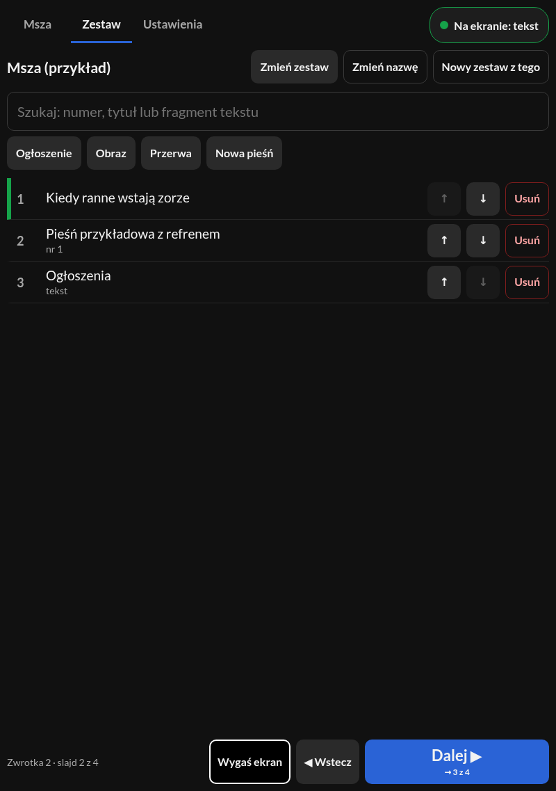
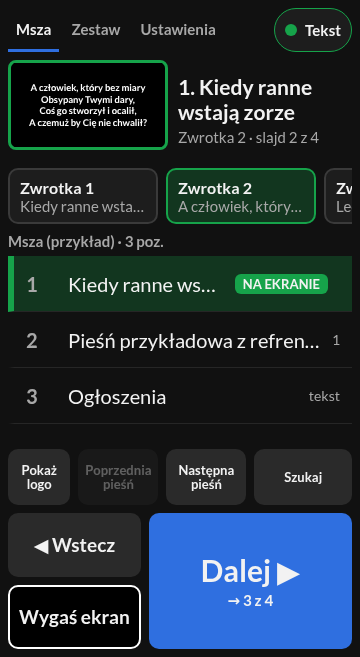
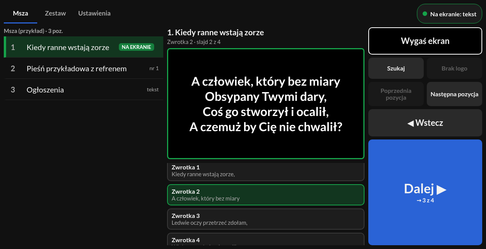
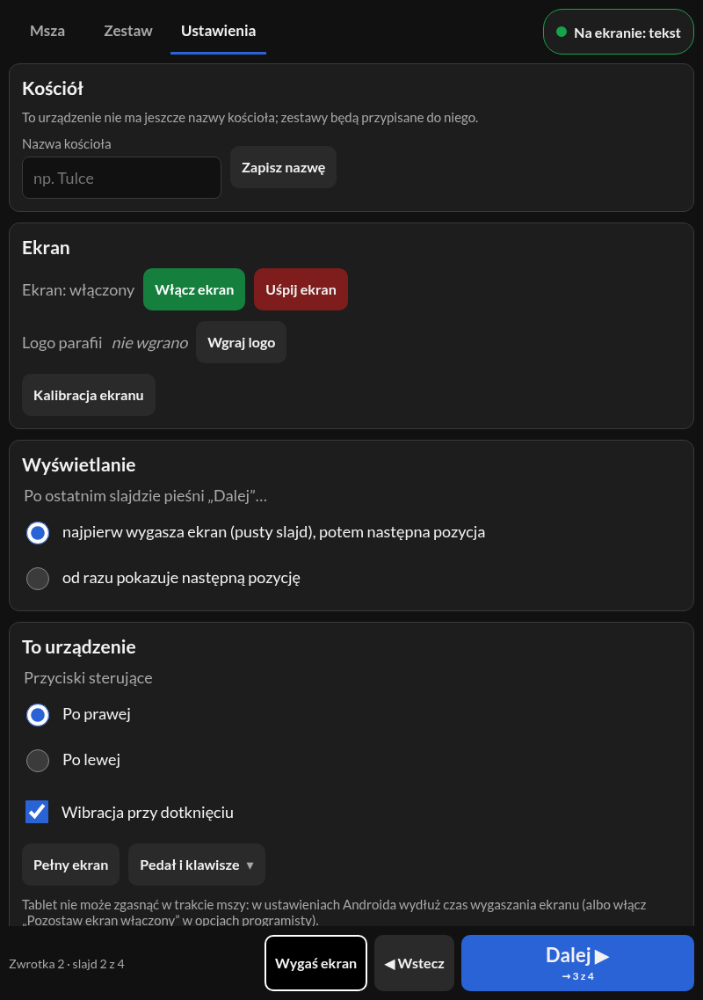

# sursum — instrukcja dla obsługi

Dla organisty, zakrystianina i każdego, kto wyświetla teksty pieśni podczas mszy. Pilot to strona
w przeglądarce na tablecie, telefonie lub komputerze. Ekran (projektor lub monitor) pokazuje
dokładnie to, co duży podgląd w pilocie.

## Najważniejsze w jednym akapicie

Pilot ma trzy zakładki: **Msza** (prowadzenie mszy), **Zestaw** (przygotowanie) i **Ustawienia**.
W zakładce Msza duży niebieski **Dalej ▶** przechodzi do następnego slajdu, a napis pod nim mówi,
co się stanie („→ 3 z 7”, „→ przerwa”, „→ 2. Barka”). **Wygaś ekran** jednym dotknięciem gasi
ekran; wtedy ten sam przycisk zmienia się w **Pokaż tekst**. Dotknięcie pozycji zestawu albo
kafelka zwrotki od razu pokazuje ją wiernym. W zakładce Zestaw nic nie trafia na ekran samo.



## Przed mszą

1. **Włącz ekran.** Dotknij napisu stanu w prawym górnym rogu (np. „Na ekranie: tekst”). Otworzy
   się okno **Ekran** z przyciskiem **Włącz ekran**, jeśli sursum steruje zasilaniem projektora lub
   monitora. Projektor rozgrzewa się do minuty. Jeśli zasilanie nie jest skonfigurowane, włącz
   projektor jego własnym pilotem.
2. **Otwórz pilota** (zakładka w przeglądarce lub skrót na ekranie tabletu). Kropka obok
   napisu stanu w prawym górnym rogu mówi, co widzą wierni: **zielona** – tekst lub obraz,
   **szara pusta** – ekran wygaszony, logo albo przerwa, **czerwona** – pilot nie ma połączenia.
   Za pierwszym razem pilot poprosi o **PIN** i nazwę urządzenia, np. „Tablet organisty”; potem
   pamięta połączenie.
3. **Przygotuj zestaw** w zakładce **Zestaw**:
   - **Zmień zestaw** pokazuje zestawy od najnowszego i pozwala utworzyć **Nowy zestaw**;
     **Zmień nazwę** poprawia nazwę bieżącego. **Usuń zestaw** trzeba przytrzymać; zaraz potem
     można go przywrócić przyciskiem **Cofnij** w dymku na dole. Nie da się usunąć zestawu, którego
     pozycja jest właśnie na ekranie.
   - W polu wyszukiwania wpisz numer, początek tytułu albo kilka słów z tekstu. Polskie znaki nie
     są potrzebne („zdrowas” znajdzie „Zdrowaś”). **+ Dodaj** dopisuje pieśń na koniec zestawu i
     wyszukiwanie zostaje otwarte, więc można dodać kilka pieśni po kolei. Pieśni, które już są
     w zestawie, mają znaczek „w zestawie”.
   - Dotknięcie tytułu pieśni otwiera jej **kartę**: tekst wszystkich slajdów oraz **Dodaj do
     zestawu** (dla pieśni, która już jest w zestawie: **Dodaj jeszcze raz**), **Edytuj** i
     **Pokaż teraz na ekranie**. Ogłoszenia, obrazy i przerwy nie mają karty; żeby poprawić
     ogłoszenie, usuń je i dodaj ponownie.
   - Strzałki ↑ ↓ przesuwają pozycje. **Usuń** trzeba przytrzymać; pomyłkę cofa **Cofnij** w
     dymku na dole albo **Cofnij usunięcie** pod listą.
   - **Ogłoszenie** dodaje slajdy z tekstem (pusta linia zaczyna nowy slajd), **Obraz** dodaje
     plakat (PNG, JPEG lub WebP), a **Przerwa** pusty slajd, np. na czas homilii.



Po starcie urządzenia ekran zawsze pokazuje najpierw **logo**, a pozycja w zestawie jest
zachowana. Wystarczy dotknąć **Pokaż tekst** (albo dowolnej pozycji zestawu), żeby wrócić do
tekstu.

## W trakcie mszy

| Chcę… | Dotknij |
|---|---|
| następny slajd | **Dalej ▶** (albo pedał) |
| poprzedni slajd | **◀ Wstecz** |
| następną / poprzednią pozycję zestawu (pieśń, ogłoszenie, przerwę) | **Następna pozycja** / **Poprzednia pozycja** |
| konkretną zwrotkę lub refren | jej kafelek („Zwrotka 2”, „Refren”) pod podglądem |
| konkretną pozycję zestawu | jej wiersz na liście |
| wygasić ekran | **Wygaś ekran**; z powrotem: **Pokaż tekst** |
| pokazać logo parafii | **Pokaż logo**; z powrotem: **Pokaż tekst**. Napis **Brak logo** znaczy, że logo nie wgrano (Ustawienia → Ekran) |
| szybko pokazać pieśń spoza zestawu | **Szukaj**, potem **Pokaż teraz** |

- Napis pod **Dalej ▶** mówi, co się stanie. Żółty podpis („→ 2. Barka”) oznacza, że następne
  dotknięcie zaczyna kolejną pieśń.
- Po ostatnim slajdzie pieśni **Dalej ▶** najpierw wygasza ekran (pusty slajd „przerwa”), a
  dopiero następne dotknięcie pokazuje pierwszą zwrotkę kolejnej pieśni. Wierni nie widzą więc
  tekstu następnej pieśni, zanim się zacznie. Można to wyłączyć w **Ustawienia → Wyświetlanie**.
- Gdy ekran jest wygaszony, **Dalej ▶** przesuwa slajdy „pod zasłoną” (tak mówi podpis), a wierni
  nic nie widzą. Dotknięcie konkretnej pozycji, kafelka zwrotki albo **Pokaż teraz** od razu
  odsłania ekran.
- **Szukaj** otwiera okno wyszukiwania. **Pokaż teraz** od razu wyświetla pieśń: jeśli jest w
  zestawie, przechodzi do niej, a jeśli nie, wstawia ją za bieżącą. **+ Do zestawu** tylko ją
  dopisuje na koniec.
- Każde okno (wyszukiwanie, karta pieśni, ustawienia) zostawia przyciski sterowania odsłonięte:
  **Wygaś ekran** i **Dalej ▶** działają także wtedy, gdy okno jest otwarte.
- Zielony znaczy „wierni to widzą”. Gdy ekran jest wygaszony, pokazuje logo albo przerwę, bieżąca
  pozycja ma szary znaczek „pod zasłoną” albo „przerwa” zamiast zielonego „na ekranie”.
- Jeśli dwie osoby naciśną **Dalej** w tej samej chwili, ekran przesunie się tylko raz, a drugi
  pilot pokaże „Już przełączone przez inny pilot”.
- Z zakładek **Zestaw** i **Ustawienia** (na telefonie i tablecie w pionie) przyciski **Wygaś
  ekran**, **Wstecz** i **Dalej** są cały czas na dole ekranu.

Na telefonie wszystko mieści się na jednym ekranie, a na tablecie w poziomie albo komputerze
przyciski są w kolumnie z boku. W **Ustawienia → To urządzenie** można przenieść przyciski na
lewą stronę.

| Telefon | Tablet w poziomie |
|---|---|
|  |  |

### Pedał lub pilot do prezentacji

Pedał (Bluetooth) albo pilot do prezentacji działa od razu: zwykle wysyła klawisze „Page Down /
Page Up”, które znaczą **Dalej** i **Wstecz**. Jeśli Twój pedał wysyła coś innego, otwórz
**Ustawienia → Pedał i klawisze**, dotknij **Naucz** przy wybranej akcji i naciśnij pedał.
Ustawienie zapamiętuje to jedno urządzenie. Przytrzymanie pedału nie przewija wielu slajdów naraz.

Na tablecie z Androidem po sparowaniu pedału może zniknąć klawiatura ekranowa; włącz ją w
ustawieniach Androida („Pokazuj klawiaturę ekranową” przy klawiaturze fizycznej) ⚠ do sprawdzenia
na tablecie parafii.

## Nowa pieśń

**Zestaw → Nowa pieśń** (albo **Nowa pieśń: „…”**, gdy wyszukiwanie nic nie znalazło). Wystarczy
zwykły tekst:

```text
1. Pierwsza zwrotka,
druga linia zwrotki.

Ref. Refren,
druga linia refrenu.

2. Druga zwrotka…

Ref.
```

- Zwrotki oddziela pusta linia; numer na początku („1.”) można pominąć.
- Refren zaczyna się od „Ref.”. Samo „Ref.” w osobnym akapicie powtarza refren w tym miejscu.
- „||” na końcu linii zaczyna nowy slajd; za długa zwrotka i tak podzieli się sama.
- Przyciski **+ Zwrotka**, **+ Refren**, **+ Most**, **Nowy slajd** wstawiają to w miejscu kursora.
- Obok widać slajdy dokładnie tak, jak pojawią się na ekranie.
- **Zapisz** zapisuje pieśń; **Zapisz i pokaż na ekranie** od razu ją wyświetla. Zamknięcie z
  niezapisanymi zmianami pyta „Odrzucić zmiany?”.
- Kto zna OpenSong, może pisać jak dotąd: `[V1]`, `[C]`, `[B]`. Kolejność sekcji (np. `V1 C V2 C`)
  jest w części **Zaawansowane**.

## Pieśni przygotowane w domu

Pieśni można przygotować na własnym komputerze z Windows (na Linuksie też działa) programem
**Sursum** i przynieść je do kościoła w jednym pliku. Program działa bez internetu i bez
urządzenia z kościoła; nie wyświetla niczego na ekranie, służy tylko do pieśni.

1. Pobierz plik `sursum-<wersja>-windows-x86_64.exe` (od osoby, która opiekuje się sursum w
   parafii, albo ze strony wydań) i uruchom go dwuklikiem. Instalacja nie jest potrzebna.
2. Przy pierwszym uruchomieniu Windows może pokazać niebieskie okno „System Windows ochronił ten
   komputer”. Program nie ma jeszcze podpisu cyfrowego, dlatego Windows go nie zna. Kliknij
   **Więcej informacji**, a potem **Uruchom mimo to**. Kolejne uruchomienia odbywają się już
   bez pytania.
3. Program ma dwie zakładki: **Pieśni** i **Ustawienia**. W zakładce Pieśni wyszukaj pieśń, żeby
   ją poprawić, albo dotknij **Nowa pieśń**. Pisze się tak samo jak w kościele (rozdział
   [Nowa pieśń](#nowa-pieśń)), a obok widać, jak slajdy będą wyglądać na ekranie.
4. Gdy skończysz: **Ustawienia → Baza pieśni → Eksport bazy**. Zapisz plik
   `biblioteka.sursum` (np. na pendrive albo wyślij go sobie pocztą).
5. W kościele, na pilocie: **Ustawienia → Baza pieśni → Scal bazę z pliku** i wybierz ten
   plik. Najpierw zobaczysz, co się zmieni; dopiero **Scal** zapisuje. Ten sam plik można
   wczytać wiele razy i nic się nie zdubluje. Jeśli tę samą pieśń zmieniono i w domu, i w
   kościele, zostaje jedna pieśń: pokazana jest wersja, którą zmieniano więcej razy, a druga
   czeka na przejrzenie (zobacz [Pieśni do przejrzenia](#pieśni-do-przejrzenia)).

Chcesz w domu poprawiać pieśni, które są już w kościele? Najpierw zrób **Eksport bazy** na
pilocie w kościele i **Scal bazę z pliku** w programie w domu; wtedy masz w domu te same pieśni.

Pieśni w domu leżą w folderze `%LOCALAPPDATA%\sursum` (na Linuksie `~/.local/share/sursum`).
Program może być uruchomiony tylko raz; jeśli drugie okno mówi „Sursum jest już uruchomiony”,
poszukaj pierwszego okna na pasku zadań. Gdy coś nie działa, przyda się plik `sursum.log` z
tego folderu.

## Pieśni do przejrzenia

Gdy tę samą pieśń zmieniono w dwóch miejscach (np. w domu i w kościele), po scaleniu pliku
zostaje jedna pieśń. Wszędzie pokazywana jest wersja zmieniana więcej razy, a druga czeka na
decyzję. W zakładce **Zestaw** (w programie na komputerze: **Pieśni**) pojawia się wtedy żółty
napis **Pieśni do przejrzenia: 1**, a w wynikach wyszukiwania znaczek „do przejrzenia”.

Dotknij napisu, wybierz pieśń i porównaj obie wersje. **Zostaw tę** pod wybraną wersją kończy
przegląd: ta wersja zostaje, druga znika. Jeśli każda wersja ma coś dobrego, zostaw jedną i
popraw ją potem w edytorze. Do następnego scalenia przegląd obowiązuje tylko na tym urządzeniu;
po wymianie pliku znika też w drugim kościele. Przeglądu nie trzeba robić od razu: do tego czasu
oba kościoły pokazują ten sam tekst.

## Po mszy

Dotknij napisu stanu w prawym górnym rogu i przytrzymaj **Uśpij ekran** przez półtorej sekundy
(przytrzymanie chroni przed przypadkowym wyłączeniem projektora w trakcie mszy). Projektor po
uśpieniu przez chwilę stygnie i nie da się go od razu włączyć ponownie („Projektor stygnie,
spróbuj za chwilę”). To normalne.

## Gdy coś nie działa

| Co widzę | Co zrobić |
|---|---|
| Czerwony pasek „Brak połączenia – ekran pokazuje ostatni slajd” | Przyciski są nieaktywne, a ekran nadal pokazuje ostatni slajd. Sprawdź Wi-Fi tabletu; pilot połączy się sam. |
| Żółty pasek „Ekran nie jest połączony z sursum” | Ekran w kościele nie odpowiada; urządzenie spróbuje go uruchomić ponownie. Jeśli to trwa, sprawdź zasilanie urządzenia przy projektorze. |
| Żółty pasek „Ekran jest uśpiony” | Dotknij **Włącz** na pasku. |
| Ekran czarny, choć powinien być tekst | Napis stanu mówi „Ekran wygaszony” albo „Na ekranie: logo”: dotknij **Pokaż tekst**. „Przerwa – pusty ekran” znaczy, że pieśń się skończyła: **Dalej ▶**. Bez wgranego logo „logo” jest czarnym ekranem, więc pilot nazywa je „Ekran wygaszony”. |
| Adres `http://sursum.local/` się nie otwiera | Wpisz adres IP urządzenia (np. `http://192.168.1.50/`; najlepiej ustawić go na stałe w routerze parafii). Nazwę `sursum.local` blokują często aplikacje VPN (np. Tailscale) – wyłącz je na tablecie – oraz Firefox zainstalowany jako Flatpak na Linuksie; Chrome i Chromium radzą sobie z nią. |
| Pilot prosi o PIN | To urządzenie odłączono albo wyczyszczono przeglądarkę. Wpisz PIN parafii. |
| Tablet gaśnie w trakcie mszy | W ustawieniach Androida wydłuż czas wygaszania ekranu. |
| Nic nie pomaga | Plan B: dotychczasowy komputer z OpenSong. Zapisz, co się stało, i zgłoś. |

## Ustawienia



- **Ekran**: zasilanie projektora lub monitora, **Logo parafii**, **Kalibracja ekranu**.
- **Wyświetlanie**: czy po ostatnim slajdzie pieśni najpierw jest pusty ekran (domyślnie), czy od
  razu następna pozycja. Dotyczy wszystkich pilotów.
- **To urządzenie**: strona przycisków (prawa lub lewa), wibracja, **Pełny ekran** (chowa paski
  przeglądarki), **Pedał i klawisze**.
- **Baza pieśni**: **Eksport bazy** (same pieśni, do wymiany z drugim kościołem), **Scal bazę
  z pliku**, **Import z OpenSong (ZIP)**.
- **Dane urządzenia**: **Pobierz kopię** (wszystko: pieśni, zestawy, logo, obrazy, kalibracja
  i ustawienia), **Przywróć z kopii** i **Usuń nieużywane obrazy**.
- **Urządzenia** i **O programie** (wersja, **Zainstaluj aktualizację**).

### Rzadziej używane

Każdy sparowany pilot może używać wszystkich ustawień, także tych poniżej. Dlatego zgubiony albo
obcy tablet trzeba od razu odłączyć w **Urządzeniach**, a PIN-u nie podawać osobom, które nie
obsługują ekranu.

- **Import z OpenSong (ZIP)**: spakuj cały folder OpenSong (z podfolderami *Songs* i *Sets*) i
  wybierz plik. Po imporcie okno pokazuje, ile pieśni i zestawów dodano lub zmieniono, oraz uwagi
  do konkretnych plików. Ponowny import aktualizuje tylko pieśni zmienione w OpenSong i nigdy nie
  cofa poprawek zrobionych w sursum ani nie przywraca usuniętych pieśni. Jeśli pieśń zmieniono i
  w OpenSong, i w sursum, zostają obie wersje i pieśń trafia do przejrzenia.
- **Eksport bazy** / **Scal bazę z pliku**: wymiana pieśni między kościołami. Plik `.sursum` z
  jednego kościoła scalasz w drugim. Najpierw zobaczysz, co się zmieni, i dopiero **Scal**
  zapisuje. Wczytanie tego samego albo starszego pliku niczego nie psuje. Gdy tę samą pieśń
  zmieniono w obu miejscach, zostaje jedna pieśń z wersją zmienianą więcej razy, a druga wersja
  czeka przy niej na przejrzenie; raport scalania wymienia takie pieśni. Pliki z wcześniejszych
  wersji programu nie są wczytywane.
- **Kalibracja ekranu**: tylko poza mszą. Po potwierdzeniu na ekranie w kościele pojawia się
  siatka z literami i cyframi. Przeciągnij palcem po podglądzie w pilocie, żeby zaznaczyć strefę
  bez tekstu, np. ciemną powierzchnię lub przeszkodę (czerwona strefa); tekst będzie ją omijał, a
  sama strefa będzie czarna. Zielona ramka pokazuje, gdzie zmieści się tekst. Pola liczbowe nie
  pozwalają wysunąć strefy poza ekran. Zmiany zapisują się od razu; **Zamknij** kończy kalibrację.
- **Zainstaluj aktualizację systemu** (w **O programie**, tylko na urządzeniu z obrazem sursum):
  plik `.sursum-system` zmienia system urządzenia (przeglądarkę ekranu, sterowniki, ustawienia
  ekranu). **Nigdy w czasie mszy.** Urządzenie zapisuje nowy system obok obecnego i uruchamia
  się ponownie; ekran gaśnie na kilka minut, potem pilot łączy się sam. Jeśli nowy system nie
  zadziała, urządzenie samo wraca do poprzedniego, a w **O programie** widać, jak się skończyło.
  Pieśni, zestawy, ustawienia i wersja programu zostają bez zmian.
- **Usuń pieśń z bazy** (przytrzymaj): w edytorze pieśni, np. dla duplikatów po imporcie. Pieśń
  znika z wyszukiwania; jeśli właśnie jest na ekranie, zostaje na nim do końca.
- **Urządzenia**: lista sparowanych pilotów; **Odłącz** (przytrzymaj) usuwa zgubiony lub obcy
  tablet (będzie musiał ponownie podać PIN).
- **Zainstaluj aktualizację** (w **O programie**, tylko na urządzeniu w kościele): wybierz plik
  `.sursum-app` i potwierdź. **Nigdy w czasie mszy.** Program sprawdza podpis pliku, uruchamia
  się ponownie, a ekran na kilka sekund gaśnie; pilot odświeża się sam. Nowa wersja przez pierwsze
  pół minuty jest „na próbę”: jeśli się nie uruchomi albo zawiesza, urządzenie samo wraca do
  poprzedniej wersji, a w **O programie** pojawia się informacja, że aktualizacja nie zadziałała.
  Plik bez właściwego podpisu jest odrzucany i nic się nie zmienia.
- **Przywróć z kopii** (w **Dane urządzenia**): wybierz plik `.sursum-backup` i
  potwierdź. **Nigdy w czasie mszy.** Wszystkie pieśni, zestawy, logo, obrazy i ustawienia
  zostają zastąpione zawartością kopii; program uruchamia się ponownie, a ekran na kilka sekund
  gaśnie. PIN i sparowane piloty się nie zmieniają, więc tablet, z którego przywracasz, zostaje
  sparowany. Dotychczasowe dane urządzenie zachowuje u siebie (kopia „before-restore”), na
  wypadek pomyłki. Kopię warto pobierać co jakiś czas i trzymać poza urządzeniem, np. na
  komputerze w kancelarii: po awarii karty wystarczy sparować tablet z nowym urządzeniem i
  przywrócić kopię.
- **Usuń nieużywane obrazy** (w **Dane urządzenia**): plakaty zostają na urządzeniu także po
  usunięciu ich z zestawu. Przycisk najpierw pokazuje, ile obrazów nic już nie używa i ile
  miejsca zajmują; usuwa je dopiero przytrzymanie **Usuń obrazy**. Obrazy z zestawów, logo, to,
  co jest na ekranie, i obrazy przesłane w ostatnich 10 minutach zawsze zostają. Program nigdy
  nie usuwa obrazów sam.

**Pierwsze uruchomienie:** dopóki nie ma PIN-u, nikt nie może sterować ekranem. Pierwszy pilot,
który otworzy stronę, pokazuje formularz „Ustaw PIN” (6–12 cyfr, wpisany dwa razy) z polem
**Nazwa kościoła** (np. „Tulce”); zestawy tego urządzenia będą należeć do tego kościoła. Przy
wymianie karty wpisz tę samą nazwę, a urządzenie będzie tym samym kościołem co wcześniej. Nazwę
można poprawić w **Ustawienia → Kościół**. Pilot, z którego to zrobiono, zostaje od razu
sparowany, więc można dalej konfigurować (import, kalibracja, logo). Instalator może też ustawić
PIN poleceniem `sursum-server set-pin <PIN>`; nazwę kościoła wpisuje się wtedy w Ustawieniach.
